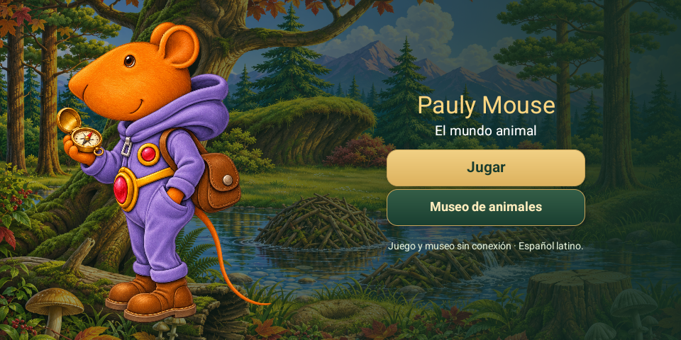
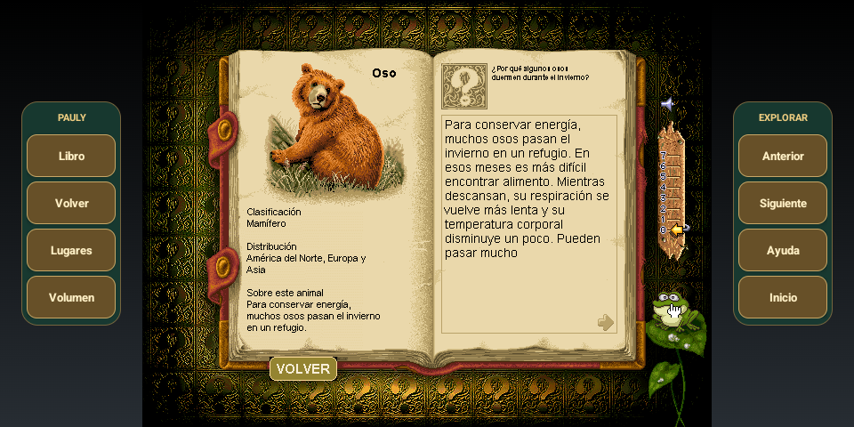

# PaulyMouse-MSDOS · Android

Adaptación educativa de **Pauly Mouse** al español latino, con el juego original,
controles táctiles y accesos laterales adicionales. Modernización con asistencia de IA.

[**Descargar APK para Android**](https://github.com/ablink3354-maker/PaulyMouse-MSDOS/releases/tag/v0.4.0)



## Qué incluye

- Nueve escenarios, personajes, dibujos y secuencias originales.
- Libro de 111 animales en español, con 222 audios de preguntas y respuestas.
- Frases caricaturescas adaptadas al español de México; risas, rugidos, llamadas
  de animales, música y efectos no verbales originales conservados.
- Libro accesible sin seleccionar antes un animal; lectura de la rana sin espera
  bloqueante, que permite parar y seguir navegando.
- Pantalla horizontal. Libro, Volver, Lugares, Volumen, Anterior, Siguiente,
  Ayuda e Inicio en los márgenes, conservando los controles originales del juego.
- Museo complementario con fotografías, historias, retos y narraciones en español.
- Regreso a Inicio desde el juego y desde el museo.

Funciona sin conexión y no necesita un servidor. La versión pública web del juego
fue cancelada; el museo HTML que aparece en este repositorio es un recurso local
empaquetado dentro de la APK.

## Instalar y jugar

Android 6 o posterior, procesador ARM64. Descarga la APK desde Releases e instálala.
Abre Pauly Mouse y elige Jugar o Museo. La primera vez se preparan los archivos locales.

Toca un animal para activar su animación. Abre el libro inferior izquierdo o el
acceso lateral Libro. Toca la cabeza de la rana para escuchar. Volver regresa al
paisaje; Inicio vuelve a la pantalla que ofreceJugar yMuseo.

Los botones laterales son extras: el juego conserva sus propios controles.
Anterior/Siguiente recorren escenarios en el paisaje y animales dentro del libro.
Volumen ajusta el volumen multimedia; el control original del libro sigue disponible.



## Compilar

Requisitos: Windows, Python 3.12, JDK de Android Studio, Android SDK 35 y build-tools 35.0.0.
Los datos del juego y museo incluidos en assets/ son los que utiliza la APK.

```powershell
python tools/download-engine.py
New-Item -ItemType Directory -Force signing
keytool -genkeypair -keystore signing/local-signing.jks -alias pauly -keyalg RSA -keysize 2048 -validity 10000
$env:PAULY_STORE_PASSWORD = Read-Host 'Contraseña de tu clave local'
./android/build.ps1
```

Resultado: dist/Pauly-Mouse-v0.4-es.apk. Puedes indicar-Sdk, -Jdk y -Python al script.
La clave privada de la distribución no está publicada. Tu compilación firmada
con otra clave necesita instalarse por separado de una que tenga distinta firma.

## Arquitectura y fidelidad

Original: Director 4 / Windows 3.1, CDWare International, 1995. La aplicación Android
utiliza el motor Director nativo de ScummVM 2.9.1 para interpretar los datos originales.
Los cambios de lógica se limitan al libro, su narración y los accesos adicionales.
Los bitmaps, casts y secuencias de los nueve escenarios se verificaron contra los
originales. Las cuatro películas originales y 110 archivos sonoros permanecen iguales.

El doblaje usa voces sintéticas nuevas, sin clonar actores. Las frases y algunos
juegos de palabras se adaptaron al español; no se presenta como doblaje literal
de todos los chistes. La separación de voz puede alterar parcialmente los efectos
que coinciden con diálogo. Algunas explicaciones antiguas del libro se actualizaron.
El arte del juego mantiene su resolución original con escalado y filtrado; la
bienvenida y el museo incorporan ilustraciones nuevas en alta resolución.

## Código, recursos y créditos

El launcher Android y la integración se distribuyen bajo GPL 3 o posterior.
ScummVM conserva su licencia GPL y sus autores. La fuente completa correspondiente
del motor 2.9.1 acompaña el archivo de código de Releases y está disponible en
https://downloads.scummvm.org/frs/scummvm/2.9.1/scummvm-2.9.1.tar.xz.

Las herramientas de extracción/localización que utilizan drxtract conservan GPL 2,
con su licencia y fuente en tools/vendor/drxtract. Los scripts de desarrollo en
tools/ documentan el proceso y utilizan las carpetas work/ de la preparación original;
consulta[el proceso de audio y recursos](docs/RECURSOS.md) para regenerarlos.

Los recursos originales de Pauly Mouse mantienen los derechos de sus autores;
la licencia del código no cambia la de esos recursos. Las fotos del museo tienen
atribuciones y licencias individuales en assets/museum/photo-credits.json y sus fichas.
Las ilustraciones nuevas de la bienvenida y museo incluyen imágenes generadas.

## Pruebas y colaboración

Se comprobaron instalación/actualización, orientación, apertura del libro sin
selección, navegación durante la voz de la rana e Inicio desde ambas secciones.
El informe de recursos verifica 304 archivos de audio en español sin errores de
decodificación y la integridad de dibujos/secuencias originales. La versión 0.4 es
una entrega de prueba para recibir resultados de distintos teléfonos.

Al informar un fallo, indica modelo de teléfono, Android, escenario, animal y
los toques que lo provocan. Mantener la jugabilidad y controles originales es la
prioridad; los controles nuevos deben seguir siendo accesos adicionales.
